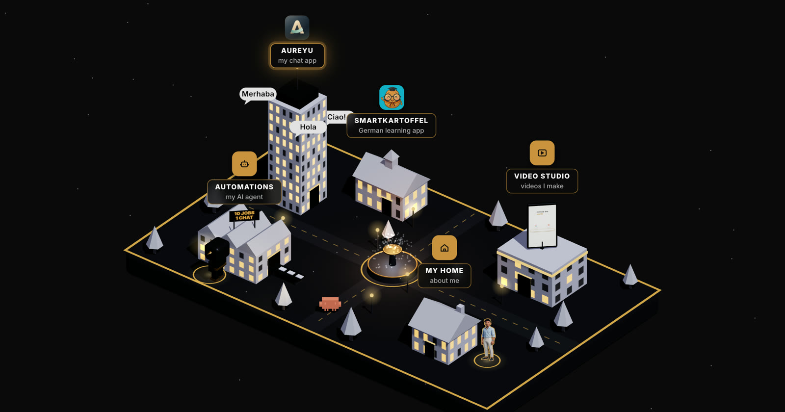

# My portfolio, as an island

Every building opens a real project: my AI agent, my apps, my videos. Built with Claude, in plain HTML, CSS and JavaScript. No framework.



## What's inside

- **`island.js`**: the 3D island (Three.js). The buildings pop up, the windows switch on, and when you tap a building the camera flies in.
- **`rooms.js` + `rooms.css`**: the page inside each building.
- **`index.html`**: everything else. Stories like on Instagram, gold ropes from my builds to teams and jobs, my tools turning around Claude, and a swinging logo at the end.

## Run it on your computer

```bash
python3 -m http.server 8000
```

Then open http://localhost:8000.

## How I made it

With Claude Code. I describe what I want in plain words, Claude writes the code, and I check every detail on my phone.

---

© Enrico Jonathan Liman. Look around and get ideas, but please don't copy my photos, videos or logo.
